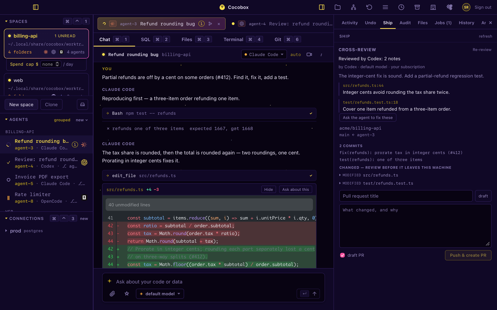

  

<h1 align="center">Cocobox</h1>

  Run your coding agents side by side, each on its own branch, with guardrails on your databases.

  <a href="https://releases.cocobox.io/Cocobox.dmg"><strong>Download for Mac</strong></a>
  &nbsp;·&nbsp;
  <a href="https://releases.cocobox.io/Cocobox.AppImage"><strong>Linux</strong></a>
  &nbsp;·&nbsp;
  <a href="https://cocobox.io/docs">Docs</a>
  &nbsp;·&nbsp;
  <a href="https://github.com/cocobox-io/cocobox/releases">Releases</a>
  &nbsp;·&nbsp;
  <a href="https://github.com/cocobox-io/cocobox/issues/new/choose">Report an issue</a>
  &nbsp;·&nbsp;
  <a href="https://cocobox.io">Website</a>

  

  

Cocobox works with Claude Code, GitHub Copilot, Codex and more. It is free to use, including commercially. The source is closed; this repository holds the releases and the issue tracker.

## Download

- **Mac (Apple silicon):** [download the latest Cocobox](https://releases.cocobox.io/Cocobox.dmg), signed and notarized. The app updates itself.
- **Linux (x86_64):** the [AppImage](https://releases.cocobox.io/Cocobox.AppImage) runs on most distributions and updates itself; the [.deb](https://releases.cocobox.io/Cocobox.deb) installs on Ubuntu and Debian.
- **A specific version:** every version, with what changed, is under [Releases](https://github.com/cocobox-io/cocobox/releases).

## Docs

Start with [Getting started](https://cocobox.io/docs/getting-started/), or browse [all the docs](https://cocobox.io/docs).

## Report a bug or ask for a feature

[Open an issue](https://github.com/cocobox-io/cocobox/issues/new/choose). Search the existing ones first, and include your Cocobox version (Settings › Privacy & updates).

Found a security problem? Don't open a public issue: [report it privately](https://github.com/cocobox-io/cocobox/security/advisories/new).

## License

See [LICENSE](LICENSE).
